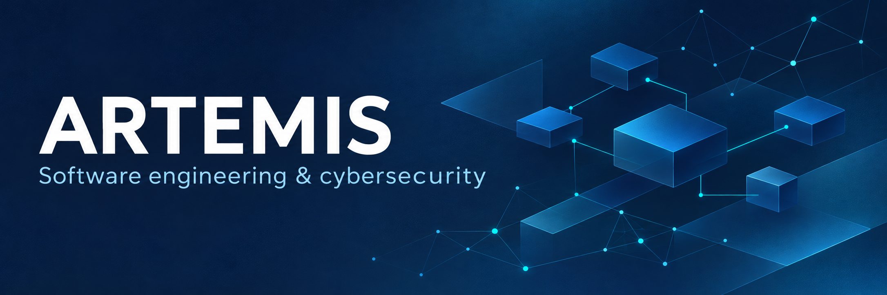
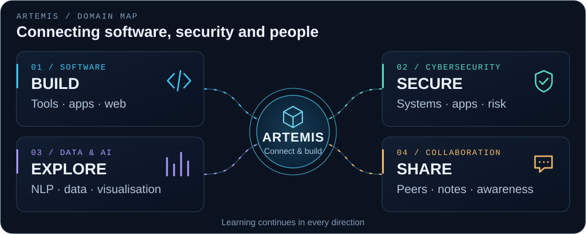
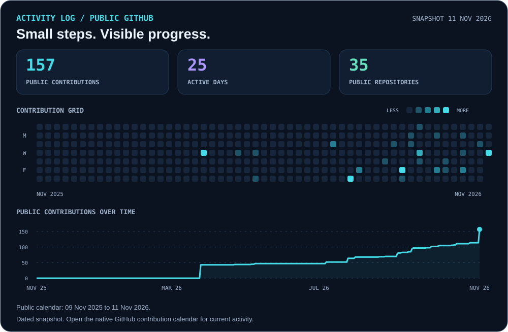
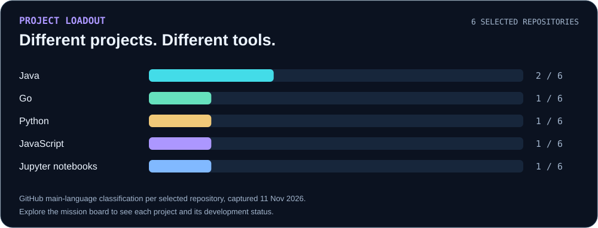

# Jacob Evariste Tapsoba · Artemis

**Software engineering, cybersecurity and learning by building.**

Based in Ouagadougou, Burkina Faso. My software engineering background connects programming, systems, networks, data and AI. Through **[JET OffSec](https://jetsecurity.us/)**, I help teams assess security risks, prioritise fixes and build awareness.

**[🧭 Explore the map](#world-map) · [🎯 Pick a mission](#mission-board) · [📊 View activity](#activity-log) · [🤝 Party up](#party-up)**

## World map

## Activity log

Snapshot: 11 November 2026. [Open the live contribution calendar](https://github.com/NeoArtemis37#year-link-2026).

## Mission board

Six starting points through my projects, experiments and practice.

| 🛠️ Build & experiment | 🧩 Explore & understand |
| :--- | :--- |
| **01 · [groovit](https://github.com/NeoArtemis37/groovit)** A Go CLI for managing local Git repositories. 🟣 `Developer-tool prototype` **Next checkpoint:** module identity and Git fixtures. | **02 · [Java chess](https://github.com/NeoArtemis37/chess_game_dev)** Desktop UI, game logic and application structure. 🔵 `Learning project` **Explore:** Java application design. |
| **03 · [Java client / server](https://github.com/NeoArtemis37/multithreated_java_program)** Socket communication and concurrent execution. 🔵 `Networking exercise` **Explore:** threads and client / server interactions. | **04 · [Sentiment analysis](https://github.com/NeoArtemis37/NLP_for_sentiment_analysis)** Python notebooks, text preparation and NLP. 🔵 `Academic project` **Explore:** the data-to-model workflow. |
| **05 · [PhisGuard](https://github.com/NeoArtemis37/PhisGuard)** Exploring browser-safety interactions. 🟣 `Early extension prototype` **Next checkpoint:** warning flow and extension assets. | **06 · [Labs & CTF notes](https://github.com/NeoArtemis37/Labs_Ctfs_Writeups)** Practice notes and challenge reflections. 🟢 `Learning archive` **Explore:** approaches, lessons and reasoning. |

<b>🎒 Open the project loadout</b>

 

The wider toolbox includes C/C++, Java, Python, JavaScript and TypeScript, web development, Windows and Linux, networks, data preparation and visualisation.

## Party up

Progress comes from comparing approaches, exchanging experiences and building with others. I share what I learn and learn from the feedback, ideas and work of the people around me.

**[YouTube](https://youtube.com/@artemisteams-h2j) · [Artémis Cyber Talk](https://open.spotify.com/show/033EuKxbsU9DsxOztoTZ3J) · [APCEN](https://apcenbf.com/)**

For a security assessment, an awareness workshop or a software collaboration:

**[JET OffSec](https://jetsecurity.us/) · [LinkedIn](https://linkedin.com/in/artemis37) · [Email](mailto:tapsobajacob18@gmail.com)**
